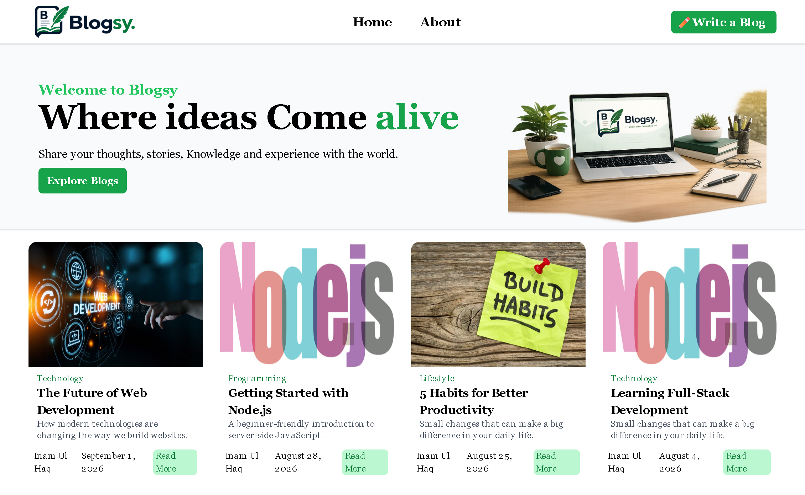
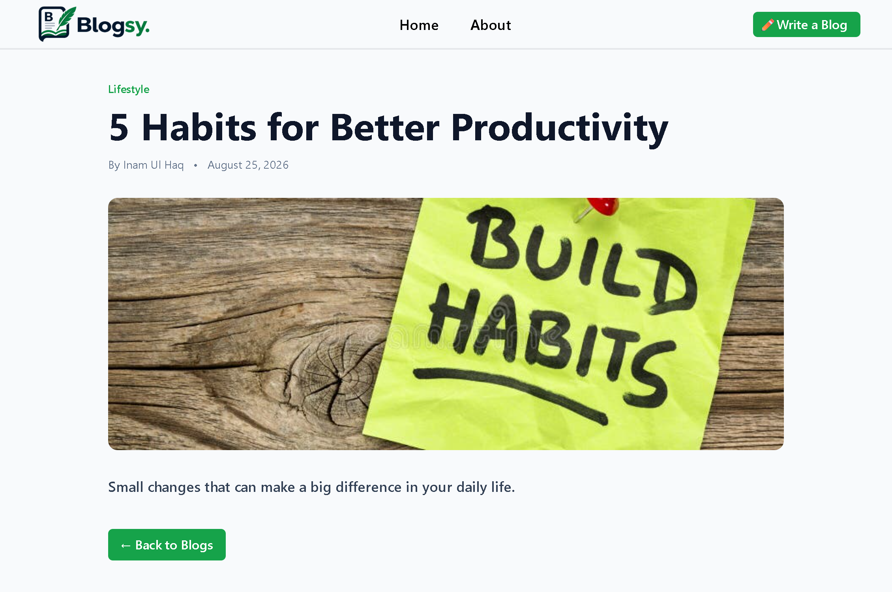
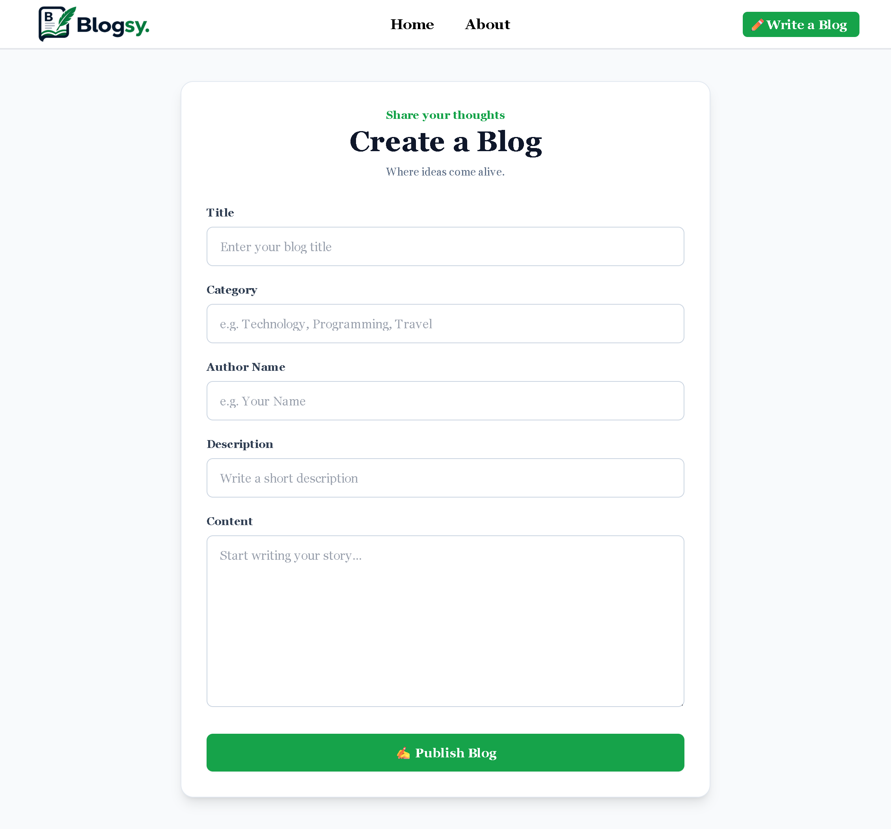
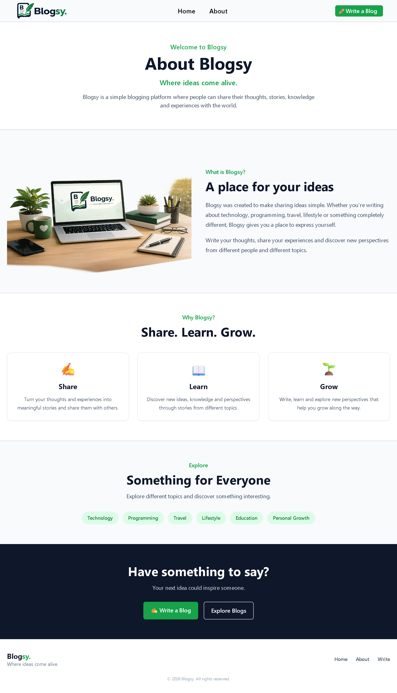

# Blogsy

### Where ideas come alive ✍️

Blogsy is a simple and responsive blog web application where users can create and read blog posts.

This project was built as a hands-on learning project to practice frontend and backend web development using **HTML, Tailwind CSS, JavaScript, Node.js, Express.js and EJS**.

---

## 📸 Screenshots

### 🏠 Homepage



### 📖 Individual Blog Post



### ✍️ Create a Blog



### ℹ️ About Page



---

## 🚀 Features

- Responsive homepage
- Responsive navigation bar
- Mobile hamburger menu
- Hero section
- Blog cards
- View individual blog posts
- Dynamic blog URLs using post IDs
- Create and publish new blog posts
- EJS templates and partials
- Tailwind CSS styling
- Express.js routing
- Responsive design for different screen sizes

---

## 🛠️ Tech Stack

| Technology | Purpose |
|------------|---------|
| HTML | Page structure |
| Tailwind CSS | Styling and responsive design |
| JavaScript | Client-side functionality |
| Node.js | Runtime environment |
| Express.js | Server and routing |
| EJS | Dynamic HTML templating |

---

## 📁 Project Structure

```text
Blogsy/
│
├── data/
│   └── post.js
│
├── public/
│   ├── css/
│   │   └── output.css
│   ├── js/
│   │   └── script.js
│   ├── favicon.png
│   ├── logo.png
│   ├── logo_with_tag.png
│   ├── hero_img.png
│   ├── webdev.jpg
│   ├── node.jpg
│   └── habits.jpg
│
├── screenshots/
│   ├── homepage.png
│   ├── blog-post.png
│   ├── create-blog.png
│   └── about.png
│
├── src/
│   └── input.css
│
├── views/
│   ├── partials/
│   │   ├── card.ejs
│   │   └── navbar.ejs
│   │
│   ├── index.ejs
│   ├── about.ejs
│   ├── create.ejs
│   └── post.ejs
│
├── .gitignore
├── app.js
├── package.json
├── package-lock.json
├── tailwind.config.js
└── README.md
```

---

## ⚙️ Installation

### 1. Clone the repository

```bash
git clone https://github.com/YOUR-USERNAME/Blogsy.git
```

### 2. Navigate to the project directory

```bash
cd Blogsy
```

### 3. Install dependencies

```bash
npm install
```

This installs all the dependencies listed in `package.json`.

---

## ▶️ Running the Project

Blogsy requires **two terminals** to run because Tailwind CSS and the Node.js server run separately.

### Terminal 1 — Start Tailwind CSS

Run:

```bash
npx tailwindcss -i ./src/input.css -o ./public/css/output.css --watch
```

This watches the Tailwind input file and automatically generates the CSS output file whenever Tailwind classes are changed.

### Terminal 2 — Start the Node.js server

Run:

```bash
nodemon app.js
```

The application will start at:

```text
http://localhost:3000
```

Open this URL in your browser.

---

## 📝 Creating a Blog

To create a new blog:

1. Click **Write a Blog** in the navigation bar.
2. Enter the blog title.
3. Enter the category.
4. Enter the author name.
5. Add a short description.
6. Write the blog content.
7. Click **Publish Blog**.

The new blog will be added to the homepage.

---

## 📖 Viewing a Blog

Each blog card contains a **Read More** button.

Clicking it opens a dynamic URL based on the blog's ID:

```text
/posts/1
/posts/2
/posts/3
```

Express.js uses the ID to find the corresponding blog post and displays it using the `post.ejs` template.

---

## 📌 Current Limitations

Blogsy currently does **not use a database**.

Blog posts are temporarily stored in a JavaScript array inside:

```text
data/post.js
```

Because of this, newly created blog posts are lost when the Node.js server is restarted.

Image uploading and user authentication are also not implemented yet.

---

## 🔮 Future Improvements

The following features can be added in future versions:

- Database integration
- User authentication
- Edit blog posts
- Delete blog posts
- Image uploading
- Search functionality
- Category filtering
- Comments
- Like and bookmark functionality
- User profiles
- Blog post timestamps
- Online deployment

---

## 🎯 Learning Objectives

This project was created to apply concepts learned in:

- HTML
- Tailwind CSS
- JavaScript
- Node.js
- Express.js
- EJS
- REST-style routing
- Responsive web design
- Server-side rendering
- Git and GitHub

---

## 👨‍💻 Author

**Inam Ul Haq Baba**

Blogsy was developed as a learning project to practice full-stack web development.


---

## 📄 License

This project is created for educational and learning purposes.